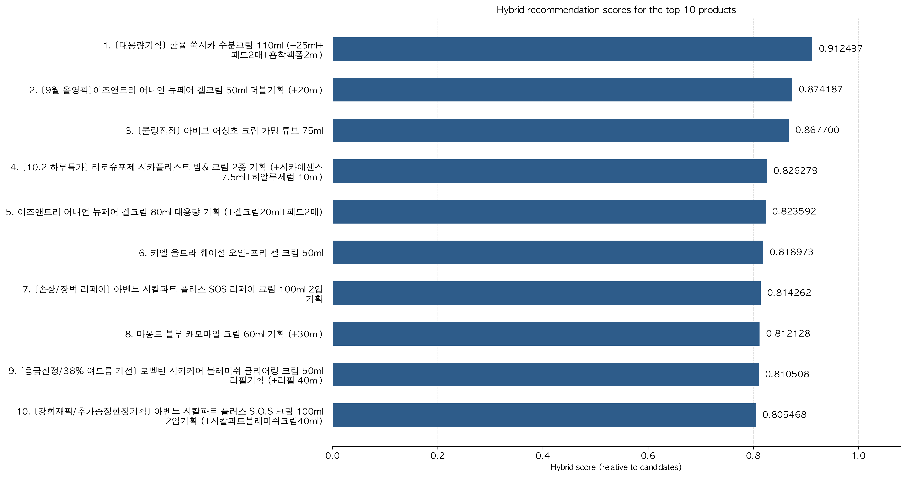

# 피부 특성과 리뷰 감성을 활용한 화장품 추천

올리브영 리뷰에서 **사용자가 어떤 상품을 좋아했는지**, **리뷰에 어떤 감정이 담겼는지**, **어떤 피부 특성을 가졌는지**를 분석해 화장품을 추천하는 프로젝트입니다. KoBERT로 리뷰의 의미를 비교하고, SVD 계열 협업 필터링으로 사용자와 상품의 평점 패턴을 학습한 뒤 두 점수를 결합합니다.

[코드와 단계별 설명](code/README.md) · [실행 방법](docs/RUNNING.md) · [현재 추천 결과](outputs/data/recommendation/recommendations.csv)

## 전체 흐름

리뷰 수집 → 데이터 정제 → 감성 분석과 평점 보정 → 피부 정보로 후보 선정 → KoBERT·협업 모델 점수 계산 → 최종 추천 순서로 진행합니다. 위 그림은 연구의 전체 개념도이며, 현재 코드의 세부 계산과 예외 처리 방식은 [추천 단계 설명](code/04_추천시스템/README.md)에 정리했습니다.

| 분석 데이터 | 규모 |
|---|---:|
| 수집 리뷰 | 12,347개 |
| 분석에 사용한 리뷰 | 11,795개 |
| 사용자 | 7,985명 |
| 상품 | 20개 |

전처리에서 유효하지 않은 리뷰 30개와 중복 리뷰 522개를 제거했습니다. 수치는 저장된 [전처리 통계](outputs/reports/preprocessing/summary.json)와 [추천 실행 정보](outputs/reports/recommendation/run_info.json)에 해당합니다.

## 어떤 결과를 얻을 수 있나요

### 사용자 한 명에게 맞춘 추천

사용자의 평점 이력과 피부 프로필을 반영해 아직 리뷰하지 않은 상품을 추천합니다. 아래는 `vwaaang` 사용자에게 생성된 결과로, 피부 정보는 건성·쿨톤·각질/모공입니다.

막대는 **추천 후보 안에서 정규화한 상대 점수**입니다. 정확도나 피부 적합 확률을 뜻하지 않습니다. 점수가 높은 상품부터 순위를 매기며, 현재 기본 설정은 콘텐츠와 협업 점수를 각각 50%씩 반영합니다.

### 피부 타입별 추천과 리뷰 분포

건성·지성·복합성 등 타입별 사용자들의 선호를 모아 추천 목록을 각각 생성합니다. 그 상품들에 달린 리뷰의 피부 타입별 비율도 확인할 수 있습니다.

[타입별 결과와 그래프 읽는 방법](code/05_시각화/README.md) · [타입별 추천 CSV](outputs/data/recommendation/recommendations_by_skin_type.csv)

## 코드 살펴보기

| 순서 | 폴더 | 하는 일 |
|---|---|---|
| 1 | [크롤링](code/01_크롤링/README.md) | 올리브영 상품 리뷰와 피부 정보 수집 |
| 2 | [데이터 전처리](<code/02_데이터 전처리/README.md>) | 중복 제거, 피부 정보 정리, 한국어 키워드 추출 |
| 3 | [감성분석](code/03_감성분석/README.md) | 긍정·부정 감성을 점수로 변환 |
| 4 | [추천시스템](code/04_추천시스템/README.md) | 피부 필터, KoBERT, 협업 모델로 추천 순위 계산 |
| 5 | [시각화](code/05_시각화/README.md) | 추천 점수와 상품별 피부 타입 리뷰 비율 표현 |

기존 데이터를 이용하면 크롤링은 생략할 수 있습니다. 전처리 → 감성분석 → 추천시스템 → 시각화 노트북 순서로 실행하세요. 설치와 설정은 [실행 가이드](docs/RUNNING.md)에 있습니다.

## 결과를 해석할 때

피부 리뷰 비율은 해당 특성을 가진 작성자들의 구성비입니다. 피부에 대한 효과를 입증하는 수치는 아닙니다. 추천 평가는 사용자별 마지막 긍정 상품을 보류해 수행하며, 감성 모델을 통한 정답 누수를 막기 위해 평가 시 감성 보정을 끕니다. 현재 결과에서 모든 지표에 대해 하이브리드가 우수한 것은 아니며, 비교 수치는 [추천 평가표](outputs/reports/recommendation/ranking_metrics.csv)에서 확인할 수 있습니다.

## 자료와 프로젝트 구성

- [단계별 코드 안내](code/README.md): 처리 원리, 입력·출력, 관련 이미지와 실행 파일.
- [출력 폴더](outputs/): 데이터, 그래프, 평가 리포트.
- [사전과 리소스](resources/): 감성 사전과 출처.
- [수정 및 검증 기록](docs/CHANGES.md): 알고리즘 수정 사항과 평가의 한계.
- [연구 발표자료 원본](docs/발표자료/KoBERT-SVD/README.md): PDF와 발표 당시 이미지 기록.

가상환경, 임베딩 캐시, 로컬 백업은 GitHub 업로드에서 제외합니다.
