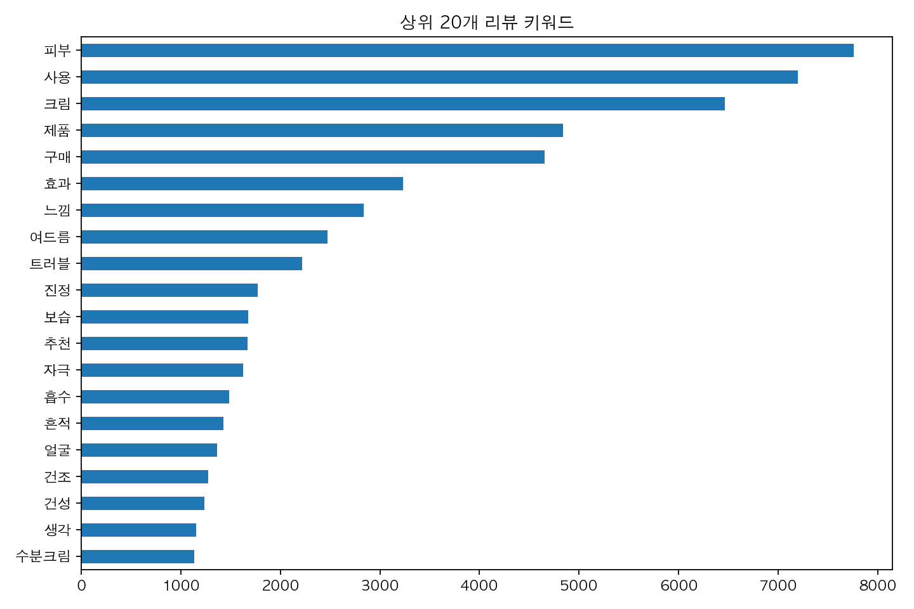

# 데이터 전처리

리뷰에서 중복과 유효하지 않은 행을 제거하고, 한국어 분석과 감성 결과 병합에 사용할 데이터를 만듭니다.

[전체 코드 안내](../README.md) · 이전 [리뷰 수집](../01_크롤링/README.md) · 다음 [감성분석](../03_감성분석/README.md)

## 처리 과정

원본 리뷰 → 유효하지 않은 리뷰와 중복 제거 → 피부 정보 정리·보완 → Komoran 형태소 분석 → 명사와 핵심 단어 추출 → `review_id` 생성 순서로 진행합니다.

| 현재 저장된 전처리 통계 | 리뷰 수 |
|---|---:|
| 원본 | 12,347 |
| 유효하지 않은 리뷰 제거 | 30 |
| 중복 제거 | 522 |
| 최종 분석 데이터 | 11,795 |

피부 타입은 1,252개 리뷰에서 보완했고, 이후에도 5,376개 리뷰는 결측입니다. 보완 여부를 컬럼으로 남겨 원래 작성된 정보와 구분합니다. [통계 JSON](../../outputs/reports/preprocessing/summary.json)

## 추출한 단어 살펴보기

막대는 리뷰에서 추출한 단어의 빈도를 보여 줍니다. 빈도가 높다고 제품 효과가 더 좋거나 추천 순위가 높다는 의미는 아닙니다.

워드클라우드는 상대적으로 자주 등장하는 단어를 더 크게 표현한 보조 그림입니다.

## 실행과 입출력

[preprocess_reviews.ipynb](preprocess_reviews.ipynb)를 위에서부터 실행하세요. Komoran을 사용하려면 Java 런타임이 필요합니다.

| 구분 | 파일 |
|---|---|
| 입력 | [원본 리뷰 CSV](../../outputs/data/raw/acne_cream_reviews.csv) |
| 출력 | [전처리 CSV](../../outputs/data/processed/Ntoken_review.csv) |
| 검증 자료 | [전처리 통계](../../outputs/reports/preprocessing/summary.json) |

`review_id`는 정제된 상품·작성자·본문·날짜로 만들며, 감성 결과를 행 번호 대신 이 ID로 병합합니다.
