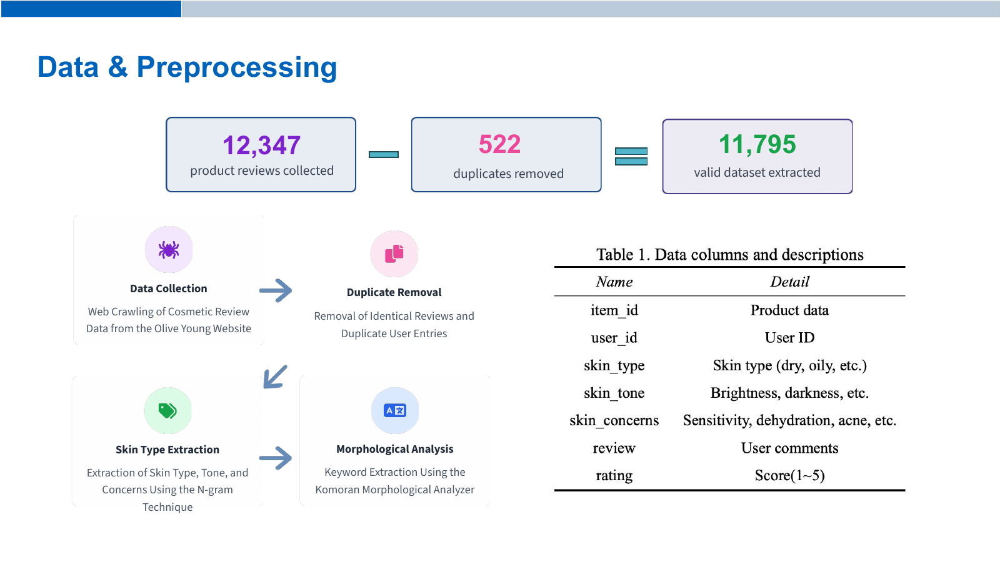

# Data and Preprocessing

추천 모델에 입력할 수 있도록 리뷰를 정제하고 피부 정보와 핵심 단어를 추출합니다.

## 처리 내용

- 중복 리뷰와 유효하지 않은 리뷰를 제거합니다.
- N-gram과 키워드를 사용해 피부 타입·톤·고민 정보를 정리합니다.
- Komoran 형태소 분석으로 명사와 핵심 표현을 추출합니다.
- 각 리뷰에 고유 ID를 부여해 후속 감성 결과와 연결합니다.

연구에서는 수집 12,347건과 최종 11,795건을 제시합니다. 그림의 중복 제거 수만으로 두 값의 차이를 설명할 수는 없으며, 현재 코드는 유효하지 않은 리뷰 30건과 중복 522건을 제거합니다. [현재 전처리 통계](../../outputs/reports/preprocessing/summary.json)

## 구현

[preprocess_reviews.ipynb](preprocess_reviews.ipynb)를 위에서부터 실행합니다. Komoran에는 Java 런타임이 필요합니다.

- 입력: [원본 리뷰](../../outputs/data/raw/acne_cream_reviews.csv)
- 출력: [전처리 리뷰](../../outputs/data/processed/Ntoken_review.csv)

[전체 구현 안내](../README.md) · [다음 단계 감성분석](../03_감성분석/README.md)
