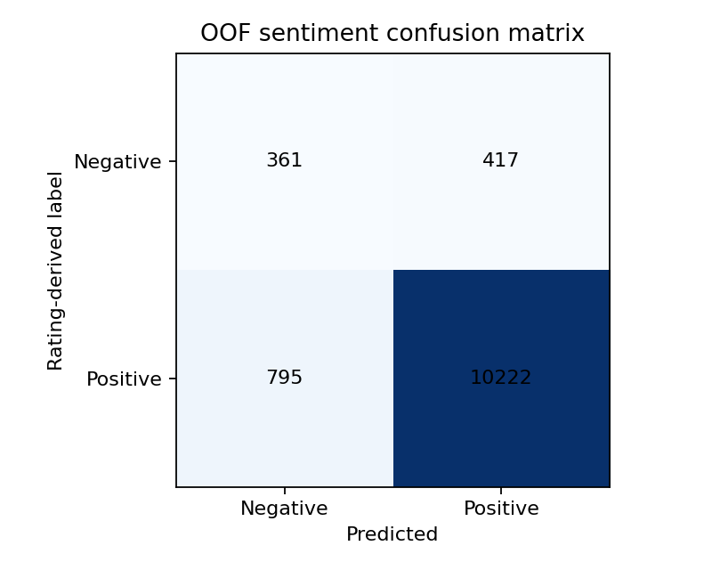

# 리뷰 감성분석

리뷰를 긍정·부정 확률로 변환하고, 추천 모델의 평점 보정에 사용할 감성 점수를 생성합니다.

[전체 코드 안내](../README.md) · 이전 [데이터 전처리](<../02_데이터 전처리/README.md>) · 다음 [추천시스템](../04_추천시스템/README.md)

## 분석 방식

KNU 감성 사전 기반 분석과 TF-IDF·로지스틱 회귀 모델을 비교합니다. 추천에 전달하는 값은 작성자 단위 5겹 교차 검증으로 생성한 OOF 긍정 확률입니다. 각 리뷰의 확률은 해당 작성자를 학습에서 제외한 폴드의 모델로 계산합니다.

```text
긍정 확률 p → sentiment_score = 2 × p - 1
p = 0.9 → 감성 점수 +0.8
p = 0.2 → 감성 점수 -0.6
```

라벨은 `1=긍정`, `0=부정`입니다. 학습 정답은 원래 평점 4점 이상 여부로 만든 대리 라벨이며, 사람이 독립적으로 판정한 감성 정답은 아닙니다.

## 감성 분류 결과



혼동행렬은 평점 기반 정답과 모델의 분류 결과를 비교합니다. 현재 저장된 결과의 전체 정확도는 0.8972, macro F1은 0.6587입니다. 클래스 불균형이 있으므로 전체 정확도와 함께 부정 클래스 성능도 확인해야 합니다. 전체 수치는 [평가 리포트](../../outputs/reports/sentiment/metrics.json)에 있습니다.

## 실행과 입출력

[analyze_sentiment.ipynb](analyze_sentiment.ipynb)를 실행하세요.

| 구분 | 파일 |
|---|---|
| 입력 | [전처리 CSV](../../outputs/data/processed/Ntoken_review.csv) |
| 사전 | [감성 사전과 출처](../../resources/lexicons/README.md) |
| 출력 | [리뷰별 감성 결과](../../outputs/data/sentiment/senti_labeled_df.csv) |
| 오분류 사례 | [오분류 리뷰 CSV](../../outputs/reports/sentiment/errors_ml.csv) |

결과에는 `review_id`, `positive_probability`, `sentiment_score`, `pred` 등이 저장됩니다. 추천 단계에서는 ID와 점수 정의를 검증한 후 병합합니다.
