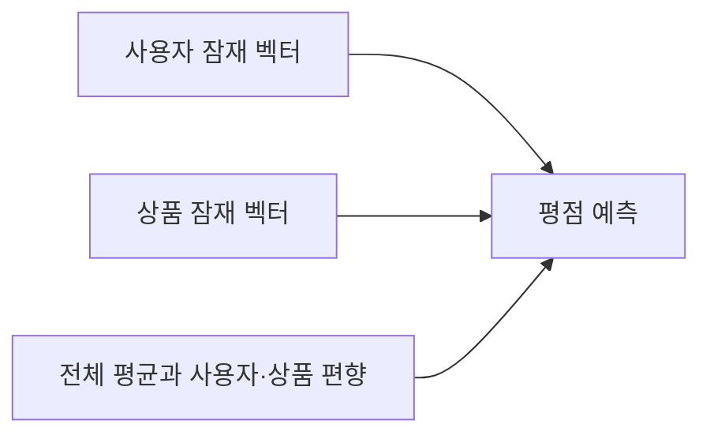

# 개인화 및 피부 타입별 화장품 추천

피부 정보로 후보를 선정하고, 리뷰 의미를 비교하는 KoBERT와 평점 패턴을 학습하는 협업 모델의 점수를 합쳐 상품 순위를 만듭니다.

[전체 코드 안내](../README.md) · 이전 [감성분석](../03_감성분석/README.md) · 다음 [시각화](../05_시각화/README.md)

## 두 모델이 반영하는 정보

| 구성 | 사용하는 정보 | 계산 결과 |
|---|---|---|
| 콘텐츠 모델 | KoBERT 리뷰 벡터와 좋아한 상품 | 코사인 유사도 |
| 협업 모델 | 사용자·상품별 감성 보정 평점 | 예상 평점 |
| 피부 필터 | 피부 정보가 있는 리뷰의 특성 비율 | 추천 후보 상품 |

관측된 평점 패턴을 바탕으로 사용자와 상품의 잠재 요인을 학습합니다. 현재 구현은 Surprise SVD를 사용할 수 있고, 설치되지 않은 경우 관측 평점만 학습하는 편향 포함 PyTorch 잠재요인 모델을 사용합니다. 저장된 실행에서는 `observed_mf`가 사용되었습니다.

## 점수가 만들어지는 과정

1. 리뷰 ID로 감성 결과를 병합하고 `rating_aug = clip(rating + 0.5 × sentiment_score, 1, 5)`를 계산합니다.
2. KoBERT로 긴 리뷰의 전체 토큰을 조각 단위로 처리하고 리뷰·상품 벡터를 만듭니다.
3. 사용자 프로필에 맞는 후보 상품을 선정합니다.
4. 후보 안에서 콘텐츠와 협업 점수를 각각 0~1 정규화합니다.
5. 기본 설정에서 두 정규화 점수를 50%씩 합산하고 내림차순으로 정렬합니다.

## 개인 사용자 추천

예시는 `vwaaang`의 건성·쿨톤·각질/모공 프로필을 사용합니다. 피부 타입·톤·고민 중 어느 하나라도 비율 기준을 충족하면 후보로 포함하며, 이미 리뷰한 상품은 제외합니다. 알려진 피부 정보가 없거나 후보가 없어 완화한 경우 그 이유를 결과에 기록합니다.

`final_score`는 후보 내 상대 추천 점수입니다. 정확도나 피부 적합 확률은 아닙니다.

## 피부 타입별 집단 추천

건성·지성·복합성 등 사용자의 최신 유효 피부 타입으로 집단을 구성합니다. 각 사용자 콘텐츠 프로필의 유사도와 협업 예상 평점을 각각 동일 비중으로 평균한 뒤 결합합니다. 콘텐츠 프로필이 없는 사용자는 콘텐츠 평균에서 제외합니다.

타입별 후보는 **해당 피부 타입 리뷰 비율 10% 이상**으로 선정합니다. 톤·고민 조건으로 확장하거나 후보 부족 시 필터를 완화하지 않습니다. 집단 추천에는 구성원이 이미 리뷰한 상품도 포함됩니다. 개인 추천과 목적이 다르기 때문입니다.

| 피부 타입 | 현재 추천 개수 |
|---|---:|
| 건성·지성·복합성 | 각 10 |
| 민감성 | 9 |
| 트러블성 | 2 |
| 약건성·중성 | 0 |

[타입별 추천 CSV](../../outputs/data/recommendation/recommendations_by_skin_type.csv) · [후보 수와 사용자 수](../../outputs/reports/recommendation/skin_type_summary.csv)

## 평가 결과와 해석

서로 다른 상품을 평가한 사용자 중 조건을 충족하는 718명의 마지막 긍정 상품을 보류했습니다. 평가에서는 감성 보정을 끕니다. 감성 효과까지 포함한 최종 운영 모델의 성능으로 해석하지 않습니다.

| 방법 | Recall@10 | NDCG@10 |
|---|---:|---:|
| 인기순 | 0.8315 | 0.3365 |
| 평균 평점 | 0.5153 | 0.2740 |
| 협업 | 0.7006 | 0.2865 |
| 콘텐츠 | 0.7730 | 0.4829 |
| 하이브리드 | 0.7521 | 0.3398 |

현재 데이터에서는 하이브리드가 모든 지표에서 우수하지 않습니다. [평가 CSV](../../outputs/reports/recommendation/ranking_metrics.csv)와 [평가 조건](../../outputs/reports/recommendation/evaluation_info.json)을 함께 확인하세요.

## 실행 파일과 결과

[recommend_products.ipynb](recommend_products.ipynb)의 첫 설정 셀에서 `USER_ID`, `TOP_K`, `CONTENT_WEIGHT`, `SKIN_THRESHOLD`를 변경할 수 있습니다. [전체 실행 방법](../../docs/RUNNING.md)

- 입력: 전처리 CSV와 감성 CSV.
- 출력: [개인 추천](../../outputs/data/recommendation/recommendations.csv), [타입별 추천](../../outputs/data/recommendation/recommendations_by_skin_type.csv), 그림과 평가 리포트.
- 모델 정보: [run_info.json](../../outputs/reports/recommendation/run_info.json).
