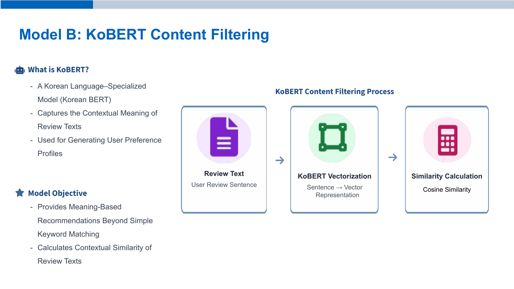
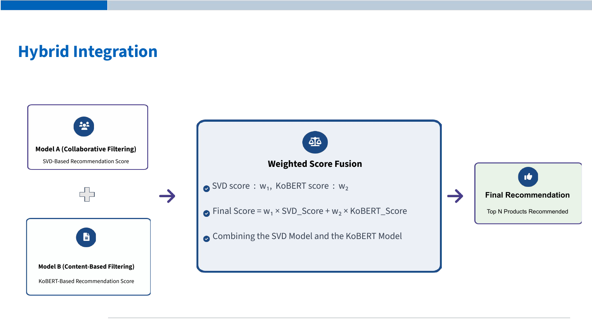

# KoBERT SVD Hybrid Recommendation

사용자의 피부 특성으로 후보를 선정하고, 협업 모델과 콘텐츠 모델을 결합해 상품을 추천합니다.

## Skin Profile Filtering

피부 타입·톤·고민 정보를 상품 리뷰의 피부 분포와 비교해 추천 후보를 줄입니다. 그림은 연구 설명용 도식이며, 현재 코드는 두 모델의 점수를 독립적으로 계산한 후 결합합니다.

## Model A Collaborative Filtering

사용자·상품 평점 관계에서 잠재 선호 패턴을 학습합니다. 감성 보정 평점을 사용해 리뷰의 감정 정보를 반영합니다.

현재 보정식은 `rating_aug = clip(rating + 0.5 × sentiment_score, 1, 5)`입니다. Surprise가 있으면 SVD를 사용하고, 없으면 관측값 기반 PyTorch 잠재요인 모델로 대체합니다. 저장된 실행은 `observed_mf`입니다.

## Model B KoBERT Content Filtering

리뷰를 문맥 벡터로 변환하고 사용자가 좋아한 상품과의 코사인 유사도를 계산합니다. 현재 코드는 긴 리뷰를 조각으로 나눠 전체 토큰을 처리합니다.

## Hybrid Integration

두 점수를 후보 안에서 각각 정규화하고 가중 합산합니다. 기본 설정은 콘텐츠 50%, 협업 50%입니다. `final_score`는 추천 순위 점수이며 정확도나 적합 확률이 아닙니다.

## 구현과 현재 결과

[recommend_products.ipynb](recommend_products.ipynb)에서 `USER_ID`, `TOP_K`, `CONTENT_WEIGHT`, `SKIN_THRESHOLD`를 설정할 수 있습니다.

- [개인 추천 결과](../../outputs/data/recommendation/recommendations.csv): 사용자 이력과 프로필을 반영하며 이미 리뷰한 상품을 제외합니다.
- [피부 타입별 결과](../../outputs/data/recommendation/recommendations_by_skin_type.csv): 최신 피부 타입으로 묶은 사용자 집단의 선호를 평균합니다. 타입 비율 기준만으로 후보를 선정하고 구성원이 리뷰한 상품도 포함합니다.
- [실행 정보](../../outputs/reports/recommendation/run_info.json): 사용 모델과 설정.
- [추천 평가](../../outputs/reports/recommendation/ranking_metrics.csv): 현재 코드에서 생성한 비교 결과. 평가에서는 감성 보정을 끕니다.

[전체 구현 안내](../README.md) · [다음 단계 시각화](../05_시각화/README.md)
