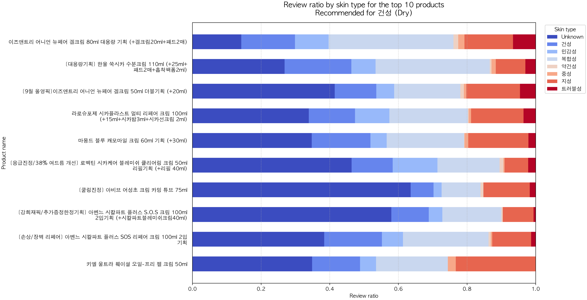

# 추천 결과 시각화

추천 점수와 추천 상품의 리뷰 구성을 이미지로 확인합니다. 모델을 재학습하지 않고 저장된 CSV로 그래프를 다시 생성할 수 있습니다.

[전체 코드 안내](../README.md) · 이전 [추천시스템](../04_추천시스템/README.md)

## 피부 타입별 추천 상품의 리뷰 구성비



위 그림을 읽는 방법은 다음과 같습니다.

- 상품 목록: **건성 집단의 선호**를 사용해 추천한 상품입니다.
- 세로 순서: 최종 추천 점수가 높은 순서입니다.
- 색상: 해당 상품의 전체 리뷰 중 각 피부 타입이 차지하는 비율입니다.
- `Unknown`: 피부 타입을 확인할 수 없는 리뷰입니다.
- 가로축: 미상 리뷰를 포함한 전체 리뷰가 분모이며 각 막대의 합은 1입니다.

따라서 건성으로 추천받았더라도 막대 안에는 지성·복합성 등 다른 작성자의 리뷰가 함께 표시됩니다. 리뷰 구성비는 피부별 효과를 입증하는 수치가 아닙니다. 후보 선정에 쓰는 비율은 알려진 피부 정보만 분모로 사용하므로 그림의 비율과 다릅니다.

### 다른 타입의 결과

[지성](../../outputs/figures/recommendation/by_skin_type_review_ratio/figure3_review_ratio_oily.png) · [복합성](../../outputs/figures/recommendation/by_skin_type_review_ratio/figure3_review_ratio_combination.png) · [민감성](../../outputs/figures/recommendation/by_skin_type_review_ratio/figure3_review_ratio_sensitive.png) · [트러블성](../../outputs/figures/recommendation/by_skin_type_review_ratio/figure3_review_ratio_troubled.png)

현재 건성·지성·복합성은 각 10개, 민감성은 9개, 트러블성은 2개입니다. 약건성·중성은 설정된 비율 기준을 충족하는 상품이 없어 빈 상태를 표시합니다.

## 추천 점수 그래프


Figure 4는 특정 사용자 한 명에게 추천한 상품의 최종 점수입니다. 타입별 추천 리뷰 비율 그림과는 추천 대상이 다릅니다. 점수는 후보 안에서 정규화한 콘텐츠·협업 점수의 가중 합입니다.

## 노트북 실행

[plot_skin_ratio.ipynb](plot_skin_ratio.ipynb)를 위에서부터 실행하세요. 추천 결과 CSV가 먼저 있어야 합니다.

| 단계 | 셀에서 하는 일 |
|---|---|
| 1~3 | 라이브러리·경로·글꼴 설정과 CSV 불러오기 |
| 4 | 피부 타입별 리뷰 비율 계산과 합계 검증 |
| 5~6 | 누적 막대그래프 함수 정의와 타입별 이미지 저장 |
| 7 | `PREVIEW_SKIN`으로 미리 볼 타입 선택 |
| 8 | 선택 사항: 타입별 추천 점수 그래프 |
| 9 | 선택 사항: 개인 추천 Figure 3과 Figure 4 |

상품명 앞 번호는 표시하지 않으며, 이미지는 300dpi PNG로 저장합니다. 8단계의 통합 추천 점수 그림은 200dpi로 저장됩니다.

## 스크립트와 저장 위치

[plot_skin_ratio.py](plot_skin_ratio.py)는 추천 노트북에서도 사용하는 보조 함수 모듈입니다. 프로젝트 루트에서 아래와 같이 실행할 수도 있습니다.

```bash
.venv/bin/python code/05_시각화/plot_skin_ratio.py
```

| 결과 | 저장 폴더 |
|---|---|
| 타입별 추천 상품의 리뷰 비율 | [by_skin_type_review_ratio](../../outputs/figures/recommendation/by_skin_type_review_ratio/) |
| 타입별 추천 점수 | [by_skin_type](../../outputs/figures/recommendation/by_skin_type/) |
| 개인 추천 그림 | [recommendation](../../outputs/figures/recommendation/) |

`variants/`는 과거 디자인 자료입니다. 현재 코드가 계산한 최신 결과와 구분해서 확인하세요.
