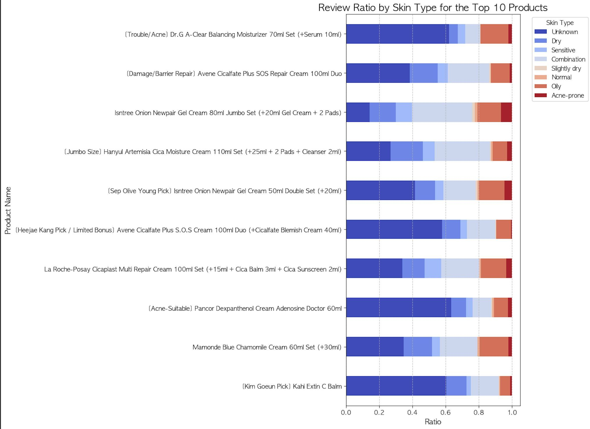

# Implementation Guide

사용자 감성과 피부 특성을 활용한 화장품 추천 연구의 구현 과정입니다. 아래 그림을 따라 데이터를 준비하고, 감성 분석과 두 추천 모델을 연결해 최종 결과를 생성합니다.

[프로젝트 소개](../README.md) · [환경 설정과 실행](../docs/RUNNING.md)

## 1 Data and Preprocessing

상품·사용자, 피부 타입·톤·고민, 리뷰 본문과 평점을 수집합니다. 중복 제거와 Komoran 형태소 분석으로 리뷰를 정리하고, 모델에 사용할 텍스트와 피부 정보를 준비합니다.

[크롤링 코드와 설명](01_크롤링/README.md) · [전처리 코드와 설명](<02_데이터 전처리/README.md>)

## 2 Sentiment Analysis

감성 사전과 TF-IDF·로지스틱 회귀로 긍정·부정 정보를 얻고, 이를 원래 평점과 결합해 감성 만족도를 반영하는 평점을 만듭니다.

[감성 분석 구현](03_감성분석/README.md)

## 3 Skin Profile Filtering

사용자 피부 특성과 상품 리뷰의 피부 정보 분포를 비교해 추천 후보를 선정합니다. 위 그림은 연구의 설명용 도식입니다. 실제 구현에서는 콘텐츠 모델과 협업 모델의 점수를 각각 계산한 뒤 최종 단계에서 결합합니다.

[피부 필터와 추천 구현](04_추천시스템/README.md)

## 4 KoBERT Content Filtering

리뷰 문장을 KoBERT 벡터로 표현하고 코사인 유사도를 계산해 단순 키워드 일치 이상의 문맥 기반 추천을 수행합니다.

## 5 Hybrid Integration

협업 점수와 콘텐츠 점수를 가중 합산하고 최종 점수가 높은 상품을 추천합니다. 현재 구현은 후보 안에서 각각 정규화한 점수를 결합합니다.

[추천 노트북](04_추천시스템/recommend_products.ipynb)

## 6 Results and Visualization

연구에서 사용한 상위 10개 상품의 피부 타입별 리뷰 비율 예시입니다. 각 막대는 상품 하나이며, 색상은 전체 리뷰에서 해당 피부 타입이 차지하는 비율입니다. 피부 타입마다 10개 상품을 별도로 추천한 결과와는 구분해야 합니다.

현재 구현에는 개인 추천과 피부 타입별 집단 추천이 모두 포함되어 있습니다. [시각화 안내](05_시각화/README.md)에서 같은 형식의 최신 그래프를 생성할 수 있습니다.

## 실행 순서

| 순서 | 파일 |
|---|---|
| 선택 | [리뷰 크롤러](01_크롤링/crawl_reviews.py) |
| 1 | [전처리 노트북](<02_데이터 전처리/preprocess_reviews.ipynb>) |
| 2 | [감성 분석 노트북](03_감성분석/analyze_sentiment.ipynb) |
| 3 | [추천 노트북](04_추천시스템/recommend_products.ipynb) |
| 4 | [시각화 노트북](05_시각화/plot_skin_ratio.ipynb) |

기존 리뷰를 사용하면 크롤링은 생략합니다. 코드가 생성하는 CSV·PNG·평가 리포트는 프로젝트의 [outputs 폴더](../outputs/)에 저장됩니다. 연구 설명용 이미지와 현재 실행 결과는 구분해 보관합니다.

공통 처리 함수는 [project_utils.py](common/project_utils.py), 피부 타입별 집단 추천은 [skin_type_recommendations.py](common/skin_type_recommendations.py)에 있습니다.
