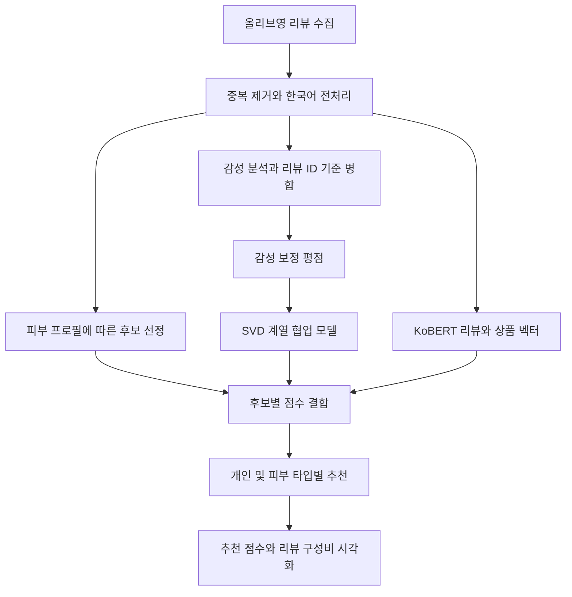

# 코드 안내

이 폴더는 리뷰 한 건이 추천 결과가 되기까지의 처리 과정을 담습니다. 각 단계의 폴더를 열면 관련 그림, 입력과 출력, 실행 파일을 확인할 수 있습니다.

[프로젝트 첫 화면](../README.md) · [설치와 실행 안내](../docs/RUNNING.md)

## 데이터가 흐르는 순서

피부 정보는 후보 상품을 좁히는 데 사용하고, 두 모델의 점수는 후보 안에서 정규화해 결합합니다. 피부 타입별 추천은 사용자 한 명의 추천과 별도로 계산합니다.

## 단계별로 살펴보기

| 단계 | 설명 | 주요 실행 파일 | 주요 출력 |
|---|---|---|---|
| [01 크롤링](01_크롤링/README.md) | 상품 리뷰와 작성자 피부 정보 수집 | `crawl_reviews.py` | `acne_cream_reviews.csv` |
| [02 데이터 전처리](<02_데이터 전처리/README.md>) | 유효하지 않은 리뷰·중복 제거, 키워드와 ID 생성 | `preprocess_reviews.ipynb` | `Ntoken_review.csv` |
| [03 감성분석](03_감성분석/README.md) | 리뷰의 긍정·부정 확률 추정 | `analyze_sentiment.ipynb` | `senti_labeled_df.csv` |
| [04 추천시스템](04_추천시스템/README.md) | 콘텐츠·협업·피부 정보를 결합 | `recommend_products.ipynb` | 개인 및 타입별 추천 CSV |
| [05 시각화](05_시각화/README.md) | 결과를 그래프로 표현 | `plot_skin_ratio.ipynb` | 추천 점수·리뷰 비율 PNG |

기존 리뷰 데이터를 사용하면 02단계부터 실행할 수 있습니다. CSV와 그림은 `code`가 아니라 프로젝트의 `outputs` 폴더에 저장됩니다.

## 입력 데이터의 구성

각 리뷰에는 상품, 사용자, 피부 타입·톤·고민, 리뷰 내용과 평점이 있습니다. 전처리 이후에는 리뷰를 식별하는 `review_id`를 부여하고 감성 결과를 이 ID로 연결합니다. 그림은 발표자료의 컬럼 개념 표이며 실제 입력·출력 컬럼은 각 단계의 설명을 참고하세요.

## 분석 결과 예시

### 리뷰에서 추출한 주요 단어

한국어 리뷰에서 추출한 단어의 빈도입니다. 상품의 효과나 추천 점수를 뜻하지 않습니다. [전처리 과정 자세히 보기](<02_데이터 전처리/README.md>)

### 피부 타입별 추천 상품의 리뷰 분포

위 상품 목록은 건성 집단의 선호로 추천한 결과입니다. 각 막대의 색상은 **그 상품에 달린 전체 리뷰의 피부 타입 구성비**입니다. 건성 비율 자체로 정렬한 그래프가 아닙니다. [시각화와 그래프 읽는 방법](05_시각화/README.md)

## 공통 코드

- [project_utils.py](common/project_utils.py): 리뷰 ID 생성, 감성 병합 검증, 피부 결측 및 고민 분리.
- [skin_type_recommendations.py](common/skin_type_recommendations.py): 피부 타입별 사용자 집단 구성과 추천 점수 집계.

단계별 처리 원리는 노트북의 Markdown 셀에도 설명되어 있습니다. 평가와 예외 처리 정책은 [실행 가이드](../docs/RUNNING.md)와 [검증 기록](../docs/CHANGES.md)을 참고하세요.
