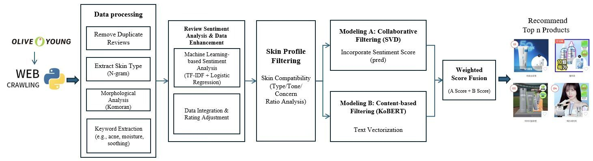
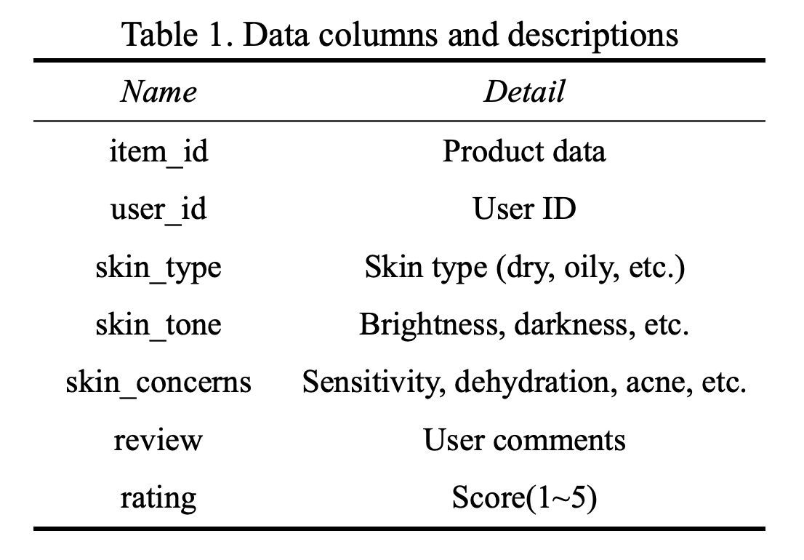
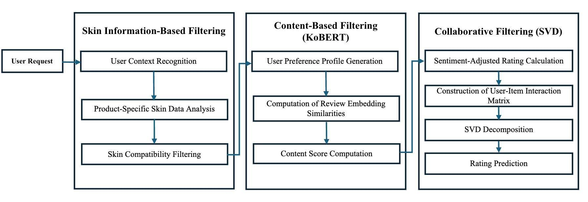
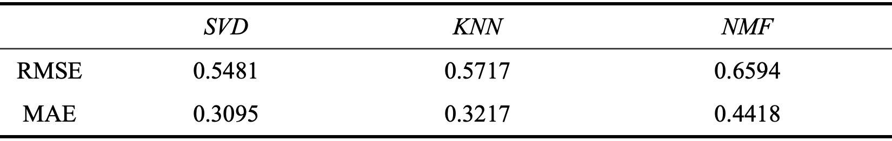
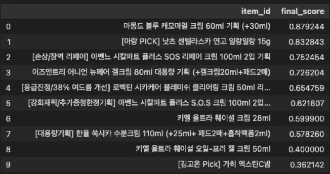

# KoBERT SVD 화장품 추천 연구 발표자료

사용자 리뷰의 감성 정보와 피부 특성을 활용한 개인화 화장품 추천 연구의 발표자료입니다. PDF 13쪽을 보관하고, PDF 내부 이미지와 전체 슬라이드 미리보기를 함께 제공합니다.

[발표자료 PDF 열기](KoBERT-SVD_발표자료.pdf) · [전체 슬라이드와 설명](슬라이드별_설명.md) · [추출 이미지 목록](이미지_목록.md)

## 파일 구성

| 경로 | 내용 |
|---|---|
| `KoBERT-SVD_발표자료.pdf` | 전달받은 원본 PDF를 이름만 정리해 보관한 파일 |
| `이미지/` | PDF에 포함된 고유 이미지 80개를 PNG로 추출한 결과 |
| `페이지/` | 도형과 텍스트를 포함해 13개 전체 슬라이드를 렌더링한 PNG |
| `슬라이드별_설명.md` | 슬라이드별 설명과 전체 페이지 이미지 |
| `이미지_목록.md` | 추출 이미지의 위치, 크기, 사용 페이지 |
| `이미지목록.json` | 페이지별 텍스트와 원본 이미지 이름, 추출 파일의 대응 관계 |

원본 파일명은 `A KoBERT-SVD Hybrid Model_chanhee.pptx.pdf`입니다. PDF 내부에 반복된 동일 이미지 데이터는 한 번만 저장했습니다. 이미지 번호는 추출 순서이며 연구의 Figure 번호와는 다릅니다. PDF의 벡터 도형과 텍스트는 개별 래스터 이미지로 추출되지 않으므로 전체 슬라이드 미리보기에서 확인할 수 있습니다.

## 주요 이미지와 설명

### 전체 연구 흐름도

PDF 4쪽입니다. 리뷰 수집부터 감성 분석, 피부 필터링, SVD·KoBERT 모델과 점수 결합까지 연구 전체 구조를 보여 줍니다.

### 데이터 항목

PDF 5쪽입니다. 상품·사용자 식별자, 피부 타입·톤·고민, 리뷰, 평점으로 구성된 입력 데이터의 항목을 설명합니다.

### 피부 필터링과 모델링 절차

PDF 7쪽입니다. 피부 정보 기반 후보 선정과 콘텐츠·협업 점수 계산 과정을 나타냅니다.

### 협업 필터링 모델 비교표

PDF 8쪽의 원문 표입니다. 현재 코드로 재계산한 수치가 아닙니다. PDF에는 이 표의 분할 방법과 평가 표본 수가 명시되어 있지 않아 현재 결과와의 직접 비교에는 추가 실험 정보가 필요합니다.

### 발표 당시 추천 상품과 점수

PDF 11쪽의 추천 결과입니다. `final_score`는 상품 순위를 정하는 추천 점수이며, 정확도나 피부 적합 확률로 해석하지 않습니다.

### 발표 당시 상품별 피부 타입 리뷰 비율

PDF 11쪽입니다. 하나의 상품 10개 목록에 대해 전체 리뷰 중 각 피부 타입이 차지하는 비율을 표현합니다. 색상은 추천 점수 또는 피부별 효과를 나타내지 않습니다.

## 현재 구현과 연결

| 자료의 단계 | 현재 코드 |
|---|---|
| 리뷰 수집 | [크롤링](../../../code/01_크롤링/crawl_reviews.py) |
| 데이터 전처리 | [전처리 노트북](<../../../code/02_데이터 전처리/preprocess_reviews.ipynb>) |
| 감성 분석 | [감성 분석 노트북](../../../code/03_감성분석/analyze_sentiment.ipynb) |
| 개인 추천과 피부 타입별 추천 | [추천 노트북](../../../code/04_추천시스템/recommend_products.ipynb) |
| 리뷰 비율 이미지 생성 | [시각화 노트북](../../../code/05_시각화/plot_skin_ratio.ipynb) |

PDF는 발표 당시의 연구 설명과 결과를 보존한 자료입니다. 현재 코드에는 감성 점수 병합·평점 보정·임베딩·평가 방식 수정 및 피부 타입별 집단 추천이 반영되어 있어 PDF의 상품 순위와 다를 수 있습니다. 현재 결과는 [추천 결과 폴더](../../../outputs/data/recommendation/)와 [피부 타입별 리뷰 비율 이미지](../../../outputs/figures/recommendation/by_skin_type_review_ratio/)에서 확인하세요.
