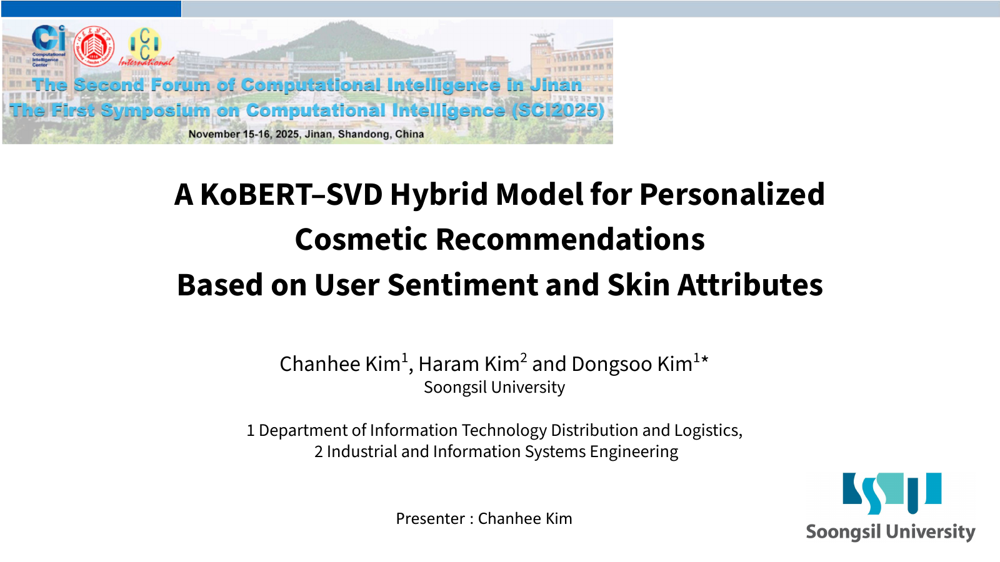
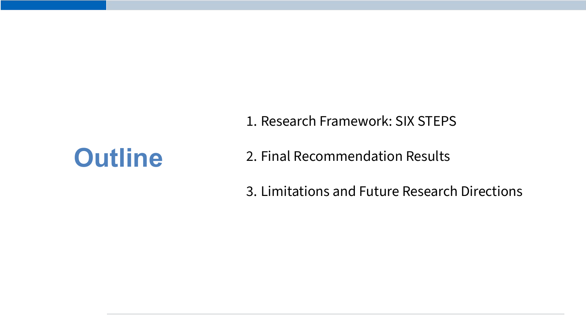
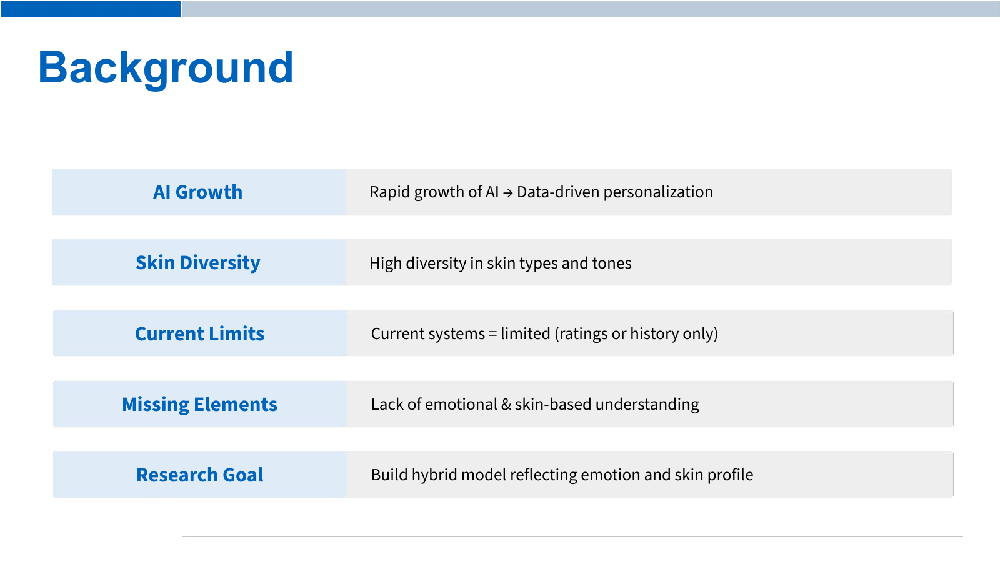
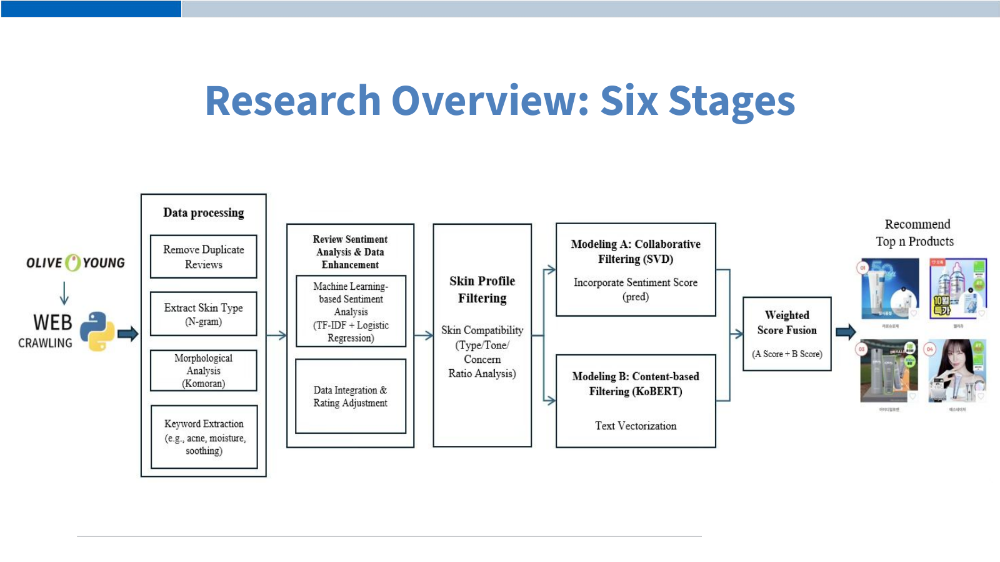
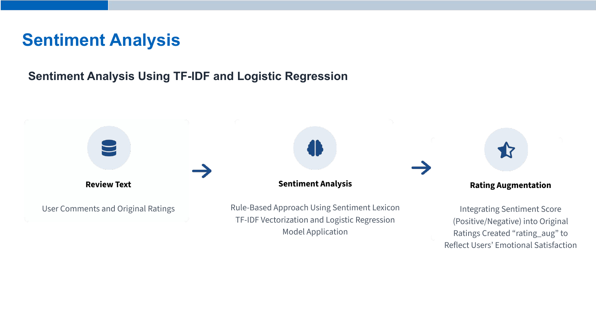
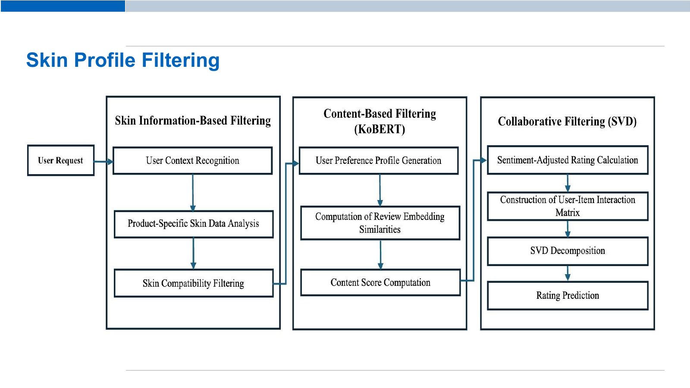
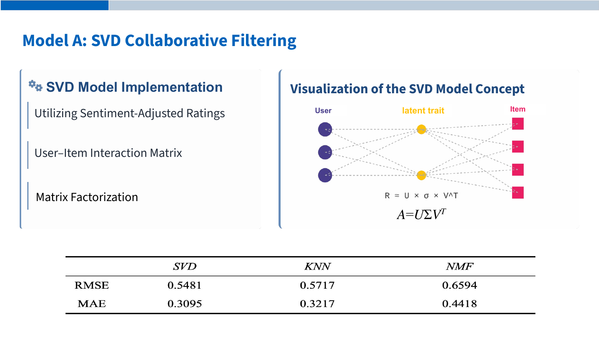
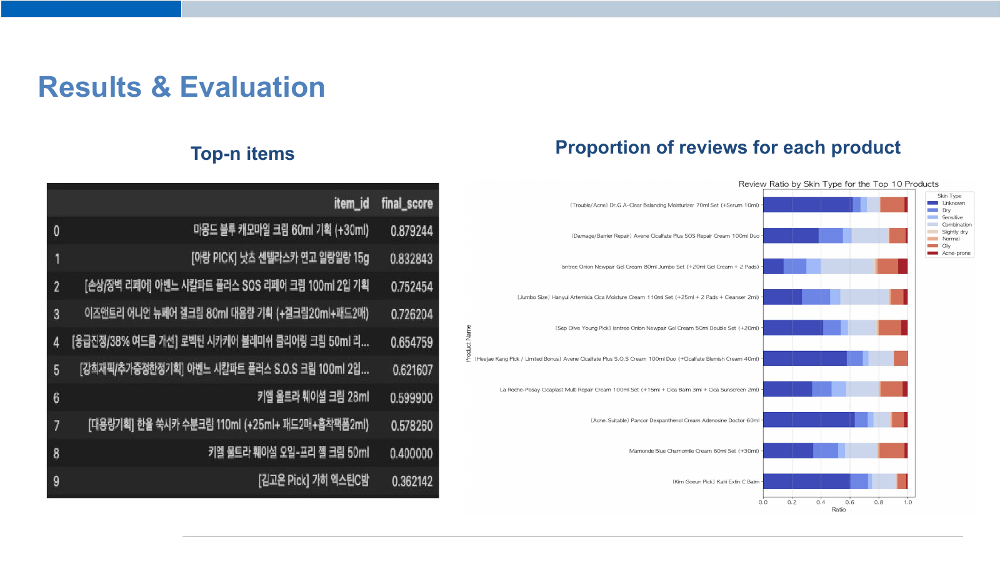
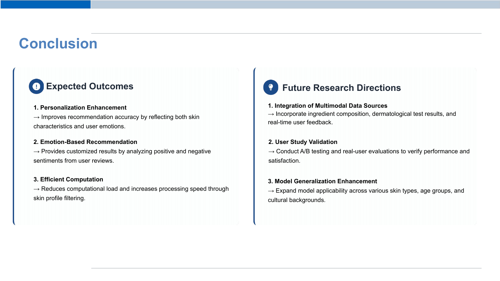
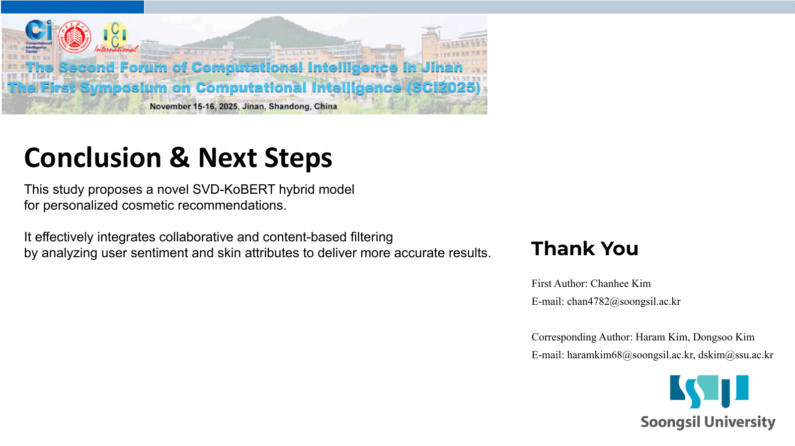

# 슬라이드별 설명

[자료 안내로 돌아가기](README.md)

## 1쪽 연구 제목과 발표자

사용자 감성과 피부 특성을 결합하는 KoBERT-SVD 기반 화장품 추천 연구의 제목과 연구진을 소개합니다.

## 2쪽 발표 구성

연구 프레임워크, 최종 추천 결과, 한계와 향후 연구 방향의 발표 순서입니다.

## 3쪽 연구 배경과 목적

평점과 이력 중심 추천의 한계를 짚고 감성 정보와 피부 프로필을 함께 반영하는 개인화 모델을 연구 목표로 제시합니다.

## 4쪽 전체 연구 절차

올리브영 리뷰 수집, 전처리, 감성 분석과 평점 보정, 피부 필터링, SVD와 KoBERT 모델, 점수 결합과 추천까지의 흐름을 보여 줍니다.

## 5쪽 데이터 수집과 전처리

중복 제거, N-gram 기반 피부 정보 추출, Komoran 형태소 분석과 데이터 컬럼을 설명합니다. 슬라이드에는 수집 12,347건, 제거 522건, 최종 11,795건이 기재되어 있습니다. 이 세 숫자는 산술적으로 일치하지 않으므로 원문 표기와 현재 전처리 통계를 구분해 확인해야 합니다.

## 6쪽 감성 분석과 평점 보정

감성 사전, TF-IDF와 로지스틱 회귀를 사용한 감성 분석 및 원래 평점에 감성 정보를 반영하는 rating_aug 개념을 설명합니다.

## 7쪽 피부 프로필 필터링

사용자 맥락과 상품별 피부 정보를 바탕으로 후보 상품을 필터링하고, 콘텐츠 점수와 협업 예측을 계산하는 세부 흐름도입니다. 연결 화살표는 콘텐츠에서 협업으로 이어지는 형태로 그려져 있습니다.

## 8쪽 SVD 협업 필터링

사용자-상품 상호작용과 잠재 요인을 설명하며 SVD·KNN·NMF의 RMSE와 MAE 비교표를 포함합니다. 이 표는 PDF에 제시된 과거 실험 수치이며, 현재 저장소의 추천 평가 리포트와 별개입니다.

## 9쪽 KoBERT 콘텐츠 필터링

한국어 리뷰를 KoBERT 벡터로 변환하고 코사인 유사도로 사용자 선호와의 유사성을 계산하는 콘텐츠 추천 과정을 설명합니다.

## 10쪽 하이브리드 점수 결합

SVD 점수와 KoBERT 점수에 가중치를 적용해 합산하고 Top N 상품을 선택하는 방식을 설명합니다. 슬라이드 식은 Final Score = w₁ × SVD_Score + w₂ × KoBERT_Score입니다.

## 11쪽 추천 결과와 리뷰 구성비

추천 상품 10개의 최종 점수 표와 상위 10개 상품의 피부 타입별 리뷰 비율 누적 막대그래프입니다. 표에서 마몽드 블루 캐모마일 크림이 0.879244로 1위입니다. 오른쪽 그림은 각 피부 타입마다 따로 추천한 결과가 아니라, 하나의 상품 목록에 달린 리뷰의 피부 타입 구성비입니다.

## 12쪽 결론과 향후 연구

피부 정보와 감성 정보를 활용한 개인화, 감성 기반 추천, 필터링을 통한 연산량 감소를 기대 효과로 제시합니다. 성분·피부 시험·실시간 피드백 통합, 사용자 연구와 A/B 테스트, 적용 범위 확장을 향후 과제로 제시합니다.

## 13쪽 마무리와 연락처

연구 내용을 마무리하고 발표자와 연구진 연락처를 안내합니다.

